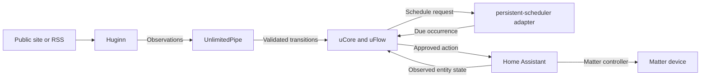

# OK Assistance and local task runs

Assessment and delivery plan, 18 November 2026.

## Current behavior

| Surface | Available behavior | Limit relevant to autonomy |
| --- | --- | --- |
| uCode Terminal and OK Assistant chat | Shared offline rules for calculations, comparisons and small text transformations. Terminal opens in Local input. BBC BASIC is selectable for lessons and programs. | The offline rules accept one bounded line and return a result or examples. They have no file, task, shell or network operations. |
| OK Assistant using Ollama | Optional loopback chat and three-stage Roundtable draft from selected material. | Chat and Roundtable return text. Roundtable roles are drafting perspectives. They carry no execution authority. |
| Skills and Snacks | Built-in Skills run through a Python registry. The catalogue records owner, lane, lifecycle, risk and intended data roots. System Snacks use a separate dispatcher. | Catalogue roots and risk are descriptive today. Skill metadata and category supply existing confirmation gates. Some paths lack a server-owned execution context. |
| uFlow workflows | Saved definitions run registered Skills in order on an explicit request. uFlow records each step, the run result and logs in its existing database. | The handler awaits the sequence in the request. Definitions and runs in this path need profile ownership and durable execution before unattended use. The saved schedule field alone does not start a run. |

The former Terminal default forwarded every input line to the BBC BASIC parser. In Local input mode, enter `help`, `calculate 6 * 7`, `is 42 >= 40?`, `PRINT "Hello"`, or `count words in plan the run`. Unsupported input returns examples. Local input uses the existing uCore service and Python runtime with no native BASIC binary, model download, or internet access.

The OK Assistant panel stores its preferences in the active uDOS profile. The offline chat mode is the default. **Explain offline replies** adds a short account of the applied rule. Terminal picks it up when its connection opens. The preferred local model is optional. Guest profiles can use offline input and save reply preferences. User, Knight, Sorcerer, Developer, Owner and Wizard profiles can use local Ollama. Owner and Wizard can manage shared Ollama downloads. These capabilities use the uDOS role from the active local session. WordPress roles apply to publishing surfaces.

## Target run contract

1. **Describe the outcome.** Accept the user's words, bounded input and optional selected material. Return a clarifying question when a required value is missing. Use the offline rules for known simple operations. An installed local model can help draft a recipe for interpretation-heavy requests. Validate its output as data.
2. **Resolve a recipe.** uFlow binds registered Skill IDs and typed parameters to an objective and input snapshot. Include the profile, permitted workspace and inputs, output destination, network policy, time and step limits, and permitted effects. Start with one small, audited allowlist of data-only operations. Require explicit eligibility per Skill and parameter shape. A catalogue `read` label alone is insufficient. For example, Vault Discovery includes a nugget extraction option and output directory.
3. **Check authority.** Derive the execution context from the profile and role on the server. Check the capability, Skill lane, parameters, resolved paths, and budget at admission and before each step. The initial lane runs offline, with no network providers. User output belongs in the profile's Vault or permitted Shared scope. Wizard curation of Public canon stays in external development tooling. Existing confirmation requirements remain in force. A role name, narrative instruction, or saved argument supplies no execution grant.
4. **Run under uFlow.** An authorized recipe can advance through its bounded steps without further prompts. Steps consume explicit inputs and produce typed outputs. Branch on a declared result or condition. Pause for missing data or an effect outside the grant. Provide cancel and retry through the existing run lifecycle. Persist checkpoints, attempts, receipts and an idempotency key for writes. Reclaim safe work after interruption and stop when the grant expires or a capability is revoked.
5. **Report the result.** Use deterministic run events for progress and receipts. The brief view shows the outcome and any required action. An explanatory view adds the selected recipe, step decisions, actual outputs and reasons for pauses or failures. A local model may phrase an explanation from those events. The receipt is authoritative.

## Delivery order and acceptance

- **Delivered with this change.** Provide shared offline input, profile settings, explicit Terminal mode selection and visible Skill catalogue metadata in the API. Reject server-owned execution fields in request and saved workflow parameters.
- **Delivered 2026-11-26 (Gate A step 1).** Workflow runs now build a server-owned `ExecutionContext` from the active profile's role and pass it to every skill step, so developer-lane authority can no longer be reached from a user profile and cannot be requested in a step. `SERVER_RUN_FIELDS` already rejects caller-supplied `context` and `execution_authorized`. Covered by `test_run_derives_user_scope_from_profile_role` and `test_run_grants_developer_scope_only_from_role`.
- **Delivered 2026-11-26 (Gate A step 2).** Every skill entry point derives authority from the session identity. `/api/skills/*` rejects unauthenticated callers, denies developer-lane skills in user scope, and refuses guest authorisation of mutating skills even when the caller sends `confirm`. The maintenance scheduler runs under an explicit system context. Covered by `test_skill_execution_authority.py`.
- **Next.** Review the first Skills and parameter schemas for local execution. Enforce a server-owned profile context at each execution entry point. Bind workflow definitions, runs and controls to the profile. Keep reviewed recipes versioned with their owner, allowed effects and removal procedure. Verify that a guest, a different profile, and a caller supplying nested execution fields cannot change authority.
- **Delivered 2026-11-26 (Gate A step 3, milestone 1).** A workflow run is admitted to the run store before its first step (`status=running`), completion updates that same row, and a restart marks orphaned runs `interrupted` exactly once. Covered by `test_workflow_run_durability.py`. Cooperative cancellation, checkpoints and resume remain.
- **Delivered 2026-11-26 (Gate A step 3, milestone 2).** A run checkpoints after every step, stops cooperatively on `POST /api/workflows/runs/{run_id}/cancel`, and halts with `timed_out` when the bounded overall budget (`RUN_BUDGET_SECONDS`) expires.
- **Delivered 2026-11-26 (Gate A step 3, milestone 3).** `POST /api/workflows/runs/{run_id}/resume` continues a stopped run from its last checkpoint: the remaining steps run under a fresh admitted run that records which run it resumed from, and running or fully executed runs are refused. Gate A step 3 is functionally complete.
- **Delivered 2026-11-26 (Gate A acceptance, partial).** The Queue panel exposes Cancel on a running run and Resume on `interrupted`, `cancelled` or `timed_out` runs, backed by store actions with tests. A run whose skill is local completes with sockets blocked, proving the run path needs no network. Remaining: repeat on the lowest supported device class with Ollama stopped and confirm one idempotent output on replay.
- **Afterward.** Connect user wording and optional Ollama recipe suggestions to the validated run contract. Verify that ambiguous requests stop for one useful question, and that concise and detailed replies describe the same persisted outcome. Add scheduled execution only after profile grants, revocation and recovery work for a single run.

uCore hosts the UI and existing services. uFlow owns task and run state. uCode owns the offline input rules and terminal transport. Preferences and run records use the existing settings-resolved stores under `UDOS_HOME`. The initial delivery adds no background worker. Remove the offline provider through the uCore route binding and uCode runtime module. Clear the `ok_assistant` profile variable to restore default preferences. Later run storage changes need a migration, retention limit and rollback procedure before rollout.

## Automation services

The full external-signal-to-device pilot requires Huginn, UnlimitedPipe,
persistent-scheduler, uCore/uFlow, and Home Assistant/Matter. A recipe that
turns on a light every morning starts at the timing stage. A recipe that
reacts to a public feed goes through observation and change detection before
uFlow schedules its effect. Home Assistant retains ownership of its local
automations and Matter fabric. The uDOS stack owns the workflows authored in
uFlow. Keep core startup, manual local runs, and HomeNook media independent of
pipeline availability.

**HomeNook ownership.** Complete the HomeNest → HomeNook rename across active
product references. Keep the uDOS-facing Home Assistant gateway, Matter bridge
contracts, deployment guidance, and integration tests in HomeNook. uFlow owns
workflow orchestration and consumes the gateway contract. Upstream Home
Assistant and Matter Server retain device and fabric ownership.

| Stage | Responsibility and ownership |
| --- | --- |
| External observation | A separately deployed Huginn sidecar runs `WebsiteAgent` and `RssAgent`. Its `PostAgent` delivers structured observations to the validation adapter. The uCore integration maintainer owns the scenarios and connector lifecycle. Huginn's `WebhookAgent` is available for inbound sources. [Huginn](https://github.com/huginn/huginn) |
| Validation and change detection | The uCore integration maintainer owns a pinned UnlimitedPipe pipeline and its versioned schemas. Normalize the fields the workflow uses, keep provenance, and compare by stable source and subject with `diff`. Run on Huginn delivery in the pilot. For a source assigned to scheduled polling, use a single polling owner. An optional public-web MCP path can provide provenance to an assistant through separate read-only configuration and state. [UnlimitedPipe](https://github.com/Fuyuki0/unlimitedpipe) |
| Orchestration | uCore authenticates producer identities. uFlow owns trigger bindings, profile grants, workflow versions, runs and receipts. An event is data. Its sender supplies no workflow, grant, entity, action or parameter override. Match the event against a user-approved binding and use the existing run contract. |
| Durable timing | Evaluate a small uCodePlus-owned Rust adapter around `persistent-scheduler`. uFlow owns the desired schedule and its revisions. The adapter persists timing registrations and supplies due occurrences via a versioned local interface. Prototype the interface and recovery with a pinned upstream revision before adoption. Upstream advertises persistence and cron. The API, delivery guarantees and timing targets are uDOS integration work. [persistent-scheduler](https://github.com/rustmailer/persistent-scheduler) |
| Device execution and feedback | Use the existing HomeNook Home Assistant gateway where it meets the contract. The first adapter uses Home Assistant service calls and state observation. Home Assistant and its supported Matter Server own commissioning, fabric and device communication over Wi-Fi or Thread. Select a verified controller and server version for the deployment. Assess MCP separately against the same grant and receipt requirements. [Home Assistant REST API](https://contributors.home-assistant.io/core/internals/rest-api/) · [Matter integration](https://www.home-assistant.io/integrations/matter/) |

### Handoffs and recovery

- **Observation to transition.** Carry a schema version, stable observation ID,
  source and subject IDs, observation time, source URL and normalized values.
  Key the baseline by source, subject and pipeline version. Establish a
  baseline on first observation. Quarantine invalid or stale inputs, and
  suppress equivalent values. Persist an accepted transition with a stable
  transition ID and pending delivery before marking the observation processed.
  Test how the pinned `diff` implementation handles state updates and crashes.
  Make baseline advancement and pending delivery recoverable together, with
  the adapter owning the recovery contract.
- **Transition to workflow.** Authenticate each producer and restrict which
  source IDs it can submit. Acknowledge after durable admission or a recorded
  suppression. Retry transient failures with bounded backoff. Deduplicate by
  producer, transition ID and trigger binding, including transport replay.
  Persist correlation from the observation to the run. Reject out-of-order
  transitions that would supersede newer state.
- **Workflow to due occurrence.** Use the host clock. Store the intended
  timezone with each calendar schedule and include its revision in occurrence
  identity. Reconcile registrations after restart and ignore obsolete
  revisions. Deduplicate run admission against the occurrence ID. Start with
  one local calendar schedule and one delayed execution window. Skip missed
  windows and overlapping runs, with a receipt. For daylight saving changes,
  skip nonexistent local times and use the first occurrence of an ambiguous
  time. Sunset requires a separately verified location and calculation source.
- **Run to device state.** Recheck the grant and event freshness at dispatch.
  Start with one explicitly allowed light and a desired-state operation such
  as `light.turn_on`. Record command acceptance separately from observed
  state. After an uncertain outcome, read state before considering a retry.
  Stop at a bounded confirmation deadline and report an unconfirmed outcome
  if state remains unavailable. A Home Assistant state observation confirms
  reported state and carries no guarantee about physical conditions beyond it.

### Delivery gates

| Gate | Deliver and verify |
| --- | --- |
| A. Durable local runs | Bind grants to profiles, persist claims and receipts, and recover one active run through uCore's lifecycle. Verify restart, cancellation, revocation and duplicate submission. The SnackMachine Shortcuts pilot uses this same admission contract. |
| B. Observation and timing, with simulated execution | Feed controlled RSS and website fixtures through Huginn and UnlimitedPipe. Verify baseline, unchanged input, one field transition, burst limits, malformed input and duplicate or reordered messages. Schedule one approved workflow through the Rust adapter. Restart each component on either side of acknowledgement and verify one admitted run per occurrence. Exercise sleep, missed windows, clock changes and daylight saving boundaries. Measure due-to-admission latency on the target host and agree a tolerance before rollout. |
| C. Closed-loop Matter pilot | Use a controlled source transition to schedule a single approved Matter light action during a short test window. Verify the complete trace and resulting Home Assistant state. Repeat with an unavailable device, a stale event, a disabled workflow, revoked access, and a lost service response. Verify standalone clock-triggered execution through the same adapter. |
| D. Broader rollout | Add trigger types and device actions individually with an owner, effect review, acceptance checks and operating budget. Keep public-web MCP queries outside device authorization. |

Start with one active run and bounded payloads, queue depth, retries, and
retention. Measure sidecar RSS, CPU, disk growth, source polling traffic, and
timing jitter on the target deployment before setting operating budgets.
Keep managed adapter state under settings-resolved `UDOS_HOME` and upstream
service data in the owning deployment. Store credentials through each
service's existing secret mechanism. Keep raw observations and tokens out of
operational logs. Show each stage's availability, next due time, suppressions
and outcomes in uCore using correlation IDs. Stop new admissions when a
required stage is unavailable and preserve receipts for inspection.

Rollback starts by disabling the affected uFlow bindings and schedules,
revoking integration grants, and cancelling eligible pending runs. Stop the
sidecar or timing adapter once its pending deliveries are recorded. Keep
uFlow history, manual local execution, and Home Assistant's native controls
available. Remove managed adapter state only after applying its retention and
export policy.
